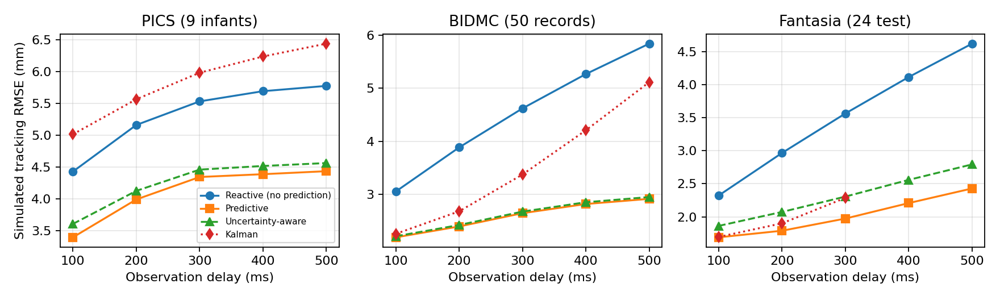

# Calibrated Probabilistic Forecasting for Latency Compensation of Respiratory Motion

**A closed-loop simulation study on three public cohorts (PICS, BIDMC, Fantasia).**

> **Paper (Overleaf, read-only):** <https://www.overleaf.com/read/cgpztggwkvyk#5c3a1e>
>
> **Supported by IEEE EMBS E-JUST SBC.**

Latency between sensing and actuation makes a robot that follows a breathing target act on outdated information. This repository studies **probabilistic respiratory forecasting as a latency-compensation layer** and asks what its predictive uncertainty is actually good for.

We train probabilistic LSTM and TCN forecasters and a deep ensemble, calibrate them with **split conformal prediction**, and drive a **simulated one-degree-of-freedom robot** that tracks a target derived from the respiratory waveform under observation delays of **0–500 ms**, with **subject-level held-out evaluation**.

> **Scope.** All robot results are simulations driven by a surrogate signal. **No physical or clinical validation is claimed.** Millimetre values are simulation units.

---

## Headline results

| Question | Finding |
|---|---|
| Does forecasting reduce error? | The ensemble cut MAE versus persistence by **37% / 58% / 71%** at 300 ms (PICS / BIDMC / Fantasia). |
| Does it improve tracking? | Forecast-based control cut simulated RMSE versus reactive control by **21.5% / 42.7% / 44.6%** at 300 ms and by **23% / 50% / 47%** at 500 ms. BIDMC: 4.62 → 2.65 mm at 300 ms, 5.84 → 2.92 mm at 500 ms. |
| Are conformal intervals calibrated? | Conformal 95% intervals reached **93.9% / 94.8% / 95.2%** coverage (PICS / BIDMC / Fantasia). PICS stays about one point short of nominal. |
| Does coverage survive a young → elderly shift? | Yes, in one small Fantasia split (4 young test subjects). The shift was benign, so this is not strong evidence. |
| Is σ a useful failure warning? | Failure-warning ROC-AUC 0.65–0.73 at 300 ms, well above chance but **below respiratory velocity up to 300 ms**. σ edges past velocity only at 500 ms (small, statistically fragile). |
| Is σ useful as a control gain? | **No.** Uncertainty-aware blending never beat plain predictive control under the validation-tuning grids used. |

### Simulated tracking RMSE versus observation delay



*Subject-mean RMSE for four controllers. Values come from the notebooks' printed ablation summaries. The Kalman controller's 400–500 ms Fantasia points were not captured in the printed output and are omitted here. Regenerate this figure from `tracking_summary_by_controller_delay.csv` once the results are exported.*


---

## Repository structure

```
.
├── README.md                     <- this file
├── LICENSE
├── requirements.txt
├── .gitignore
│
├── paper/
│   ├── README.md                 <- how to build the PDF and which figure files it expects
│   ├── main.tex                  <- IEEEtran double-blind manuscript
│   └── figures/                  <- put the PDF/PNG figures used by main.tex here
│
├── notebooks/
│   ├── README.md                 <- overview and shared pipeline description
│   ├── pics/
│   │   ├── README.md
│   │   └── pics_pipeline.ipynb
│   ├── bidmc/
│   │   ├── README.md
│   │   └── bidmc_pipeline.ipynb
│   └── fantasia/
│       ├── README.md
│       └── fantasia_pipeline.ipynb
│
├── data/                         <- raw data is NOT committed; see the READMEs
│   ├── README.md
│   ├── pics/README.md
│   ├── bidmc/README.md
│   └── fantasia/README.md
│
├── results/
│   ├── README.md                 <- table/figure catalogue and paper cross-reference
│   ├── pics/    {tables/, figures/}
│   ├── bidmc/   {tables/, figures/}
│   └── fantasia/{tables/, figures/}
│
├── scripts/
│   └── collect_results.py        <- copies tables/figures out of a notebook run folder
│
└── docs/img/                     <- summary chart shown in this README
```

---

## The three cohorts

| Cohort | Population | Subjects (test) | Signal | Evaluation protocol |
|---|---|---|---|---|
| **PICS** | Preterm infants | 9 (after quality exclusion of 1) | Abdominal inductance bands, 50 Hz (infant 1: bedside monitor, 500 Hz) | Leave-one-infant-out |
| **BIDMC** | ICU patients | 50 records from 44 patients (3 of 53 excluded) | 8-min respiration recordings | Patient-grouped 5-fold CV; all records of a patient stay in one fold |
| **Fantasia** | 20 young + 20 elderly healthy adults | 24 test (4 young + 20 elderly) | Respiration channel | Single split: train on young, test on held-out young and all elderly |

Only the respiration channel is used. See [`data/`](data/README.md) for download instructions and licensing notes.

---

## Method at a glance

1. **Causal preprocessing.** Gaps up to 0.25 s are held, longer gaps split the signal and flat-line runs are discarded. A fourth-order Butterworth band-pass is applied in one direction with the first 10 s discarded. The signal is decimated to **20 Hz** and normalised with training-subject statistics only.
2. **Windows.** History of **L = 100 samples (5 s)**. Horizons **h ∈ {2, 4, 6, 8, 10}** samples, i.e. **100–500 ms**. With observation delay d, the forecast horizon equals the delay.
3. **Forecasters.**
   - Baselines: persistence, ridge autoregression, constant-velocity Kalman filter.
   - Learned: one-layer LSTM (64 units) and causal dilated TCN (32 channels, kernel 3), each with a Gaussian head trained by negative log-likelihood, plus a deterministic TCN.
   - **Deep ensemble** of M = 5 LSTMs. Total variance is the mean member variance (aleatoric) plus the variance of the member means (epistemic).
4. **Calibration.** Split conformal intervals use a held-out validation block with scores |y − μ| / σ. We report NLL, 95% coverage (PICP), interval width and the Spearman correlation between σ and absolute error.
5. **Simulation.** A target derived from the respiratory waveform drives a delayed first-order one-degree-of-freedom robot. Controllers: reactive, predictive, validation-tuned fixed blend, uncertainty-aware (UA) blend, Kalman, plus σ-gated rate-limit and trigger variants.
6. **Failure anticipation.** Tracking failure is defined at ε = 1 mm. σ, respiratory velocity, forecast magnitude and combinations are compared by ROC-AUC with subject-level paired differences and Holm correction.

Everything is tuned on **validation subjects only**. Test subjects are never used for model selection.

---

## Reproducing the study

### Option A: Kaggle (what the study used)

1. Create a Kaggle notebook and upload one of the notebooks from [`notebooks/`](notebooks/README.md).
2. Attach the matching dataset (see the per-cohort README under [`data/`](data/README.md)).
3. Turn on a GPU accelerator (optional but faster) and run all cells with `MODE = "full"`.
4. Download `/kaggle/working/results/...` when the run finishes.

### Option B: Local

```bash
git clone <this-repo-url>
cd <repo>
python -m venv .venv && source .venv/bin/activate
pip install -r requirements.txt
jupyter lab
```

Open a notebook, edit the configuration cell (`DATA_DIR`, `RESULTS_BASE`, `MODE`), and run top to bottom. The BIDMC notebook is configured for a Kaggle input path and needs `DATA_DIR` changed to a local PhysioNet copy.

### Run modes

| `MODE` | Purpose |
|---|---|
| `smoke` | Tiny debug run to check the pipeline end to end |
| `fast` | Real data, reduced compute (PICS and Fantasia notebooks) |
| `full` | All data, final run used for the paper |

All notebooks use `SEED = 42`.

### Collecting results into this repo

```bash
python scripts/collect_results.py --run-dir /path/to/results/bidmc/full_YYYYMMDD_HHMMSS --cohort bidmc
```

This copies every CSV into `results/<cohort>/tables/` and every figure into `results/<cohort>/figures/`. See [`results/README.md`](results/README.md) for which file feeds which paper table.

---

## Where each paper table comes from

| Paper table | Content | Source file |
|---|---|---|
| Table 1 | Dataset summary | `dataset_characteristics.csv` |
| Table 2 | MAE at 300 ms | `forecast_metrics.csv` (`horizon_ms = 300`, `mae`) |
| Table 3 | NLL and 95% coverage | `uncertainty_metrics.csv` (`nll`, `picp95`, `conf_norm_5_picp`) |
| Table 4 | Simulated RMSE per controller and delay | `tracking_summary_by_controller_delay.csv` |
| Table 5 | Failure-warning ROC-AUC | `failure_prediction_metrics.csv` |
| Table 6 | Paired statistical tests | `statistical_tests.csv` |

---

## Limitations

1. The target is simulated from a respiratory surrogate. True anatomical motion differs in amplitude, phase, hysteresis and delay.
2. The robot is a one-degree-of-freedom first-order system, with no physical or clinical validation.
3. Cohorts are small (9, 50 and 24 test subjects). Fantasia is a single split with 4 young test subjects, and two BIDMC patients contribute four records each.
4. Protocols differ across cohorts (band, learning rate, recording length), so cross-cohort comparisons are descriptive.
5. The failure threshold (1 mm) is a fixed engineering choice that gives high failure prevalence in two cohorts.
6. Conformal guarantees assume exchangeability, which temporal dependence violates. Coverage is measured, not assumed.
7. With n = 9, Holm-corrected tests in PICS cannot reach significance, so non-significance there is not equivalence.
8. The UA gate was tuned on grids whose upper end was binding in PICS and Fantasia, and the Kalman parameters lay at a grid corner, so those comparisons are conditional on the grids.
9. **The PICS run predates later pipeline changes**: it has no UCPC or trigger controllers, no plant or measurement-noise sensitivities and no validation-only model-selection table.

---

## Acknowledgment

This work is supported by **IEEE EMBS E-JUST SBC**.

## Citation

```
Authors. "Calibrated Probabilistic Forecasting for Latency Compensation of
Respiratory Motion: A Closed-Loop Simulation Study on Three Public Cohorts." Under review. Paper: https://www.overleaf.com/read/cgpztggwkvyk#5c3a1e
```

The BibTeX entry will be added after review.

## License

Code is released under the MIT License (see `LICENSE`). **The datasets are not included and keep their original licenses**; follow the terms on each PhysioNet or Kaggle page.
