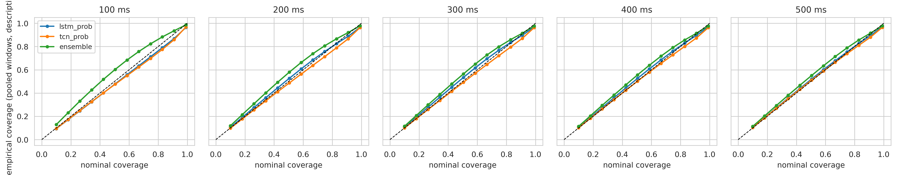
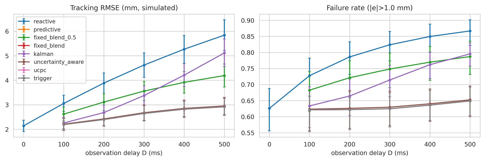
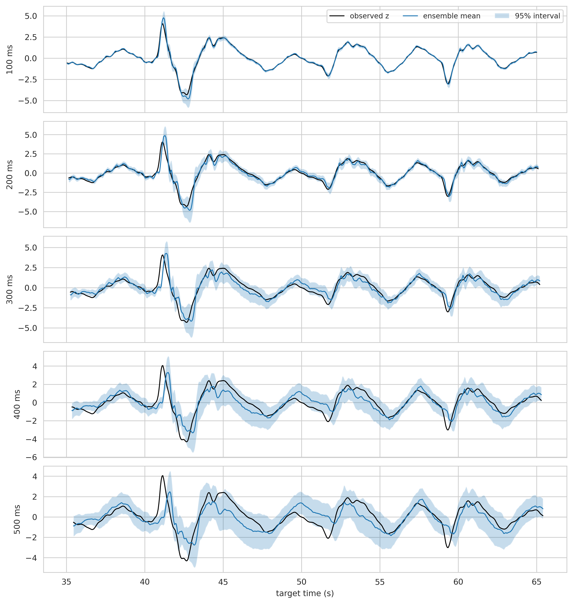
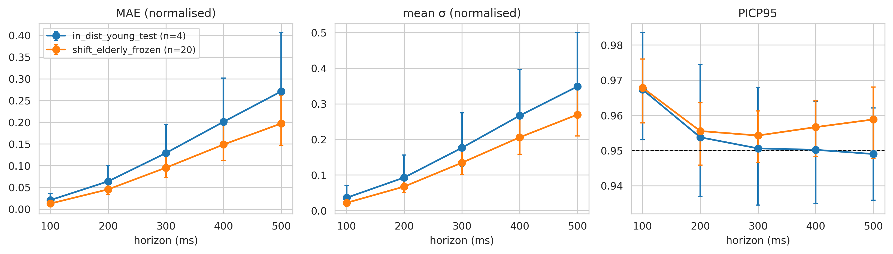

# Results

Exported tables and figures from the three full-mode runs (seed 42), one sub-folder per cohort:

```
results/
├── pics/      tables/  figures/
├── bidmc/     tables/  figures/
└── fantasia/  tables/  figures/
```

Copy them in with:

```bash
python scripts/collect_results.py --run-dir <path-to-run-folder> --cohort <pics|bidmc|fantasia>
```

`results/bidmc/tables/forecast_metrics.csv` is already included (it is the file used to fill the BIDMC TCN (prob.) cell of paper Table 2).

## Tables (CSV)

Every table is written by the notebooks via `save_table(...)`. Metric columns usually come with `_lo` / `_hi` 95% bootstrap confidence limits over subjects.

| File | Content | Used for |
|---|---|---|
| `dataset_characteristics.csv` | Per-cohort summary (rates, durations, counts) | Paper Table 1 |
| `record_quality.csv` | Per-record validity fraction and exclusion decisions | Data section |
| `split_manifest.csv` | Which subject is in train / validation / test per fold | Reproducibility |
| `forecast_metrics.csv` | Subject-mean MAE and RMSE per model and horizon (+ `_units` columns in signal units) | Paper Table 2 |
| `uncertainty_metrics.csv` | NLL, PICP at 90% and 95%, interval width, mean σ, Spearman(σ, error), and the `conf_*` conformal columns | Paper Table 3 |
| `tracking_metrics.csv` | Per-subject tracking RMSE and failure rate per controller and delay | Control results |
| `tracking_summary_by_controller_delay.csv` | Subject-mean summary per controller and delay | Paper Table 4, `fig10_11` |
| `failure_prediction_metrics.csv` | ROC-AUC of σ, velocity, forecast magnitude and combinations | Paper Table 5 |
| `failure_threshold_sensitivity.csv` | AUC at ε = 0.5, 1.0, 1.5 mm | Failure anticipation |
| `statistical_tests.csv` | Paired differences with CIs, Wilcoxon p-values, Holm-adjusted p-values | Paper Table 6 |
| `distribution_shift_performance.csv`, `distribution_shift_tests.csv` | Young vs elderly performance and tests | `fig14` |
| `ablation_results.csv`, `band_validation.csv` | Ablations and the band-pass study | `fig15` |

Notebook-specific tables:

| File | Cohort(s) | Content |
|---|---|---|
| `controller_parameter_summary.csv`, `patient_identity_audit.csv`, `validation_model_selection_log.csv`, `validation_selected_forecaster_test_performance.csv` | BIDMC | Tuned controller parameters, patient-grouping audit, validation-only selection |
| `controller_selected_on_validation.csv`, `controller_validation_selection.csv`, `forecast_selected_model_per_horizon_validation.csv`, `forecast_selected_model_test_results.csv`, `forecast_validation_selection.csv`, `group_sizes.csv` | Fantasia | Validation selection logs and group sizes |
| `inference_latency.csv` | Fantasia | Batch-1 GPU inference time per model |
| `sensitivity_actuator_tau.csv`, `sensitivity_measurement_noise.csv`, `sensitivity_excluding_fs_anomaly_subjects.csv` | Fantasia | Sensitivity studies |

## Figures

All three notebooks export the same 14 figures (PDF/PNG), saved as `figNN_<name>`:

| Figure | Content | In the paper |
|---|---|---|
| `fig01_pipeline` | Study pipeline | The pipeline figure in the paper is drawn directly in TikZ |
| `fig02_dataset_statistics` | Dataset statistics | Supplement |
| `fig03_raw_vs_filtered` | Raw versus causally filtered signal | Supplement |
| `fig04_eda_power_spectra` | Power spectra | Supplement |
| `fig05_forecasts_uncertainty` | Example forecasts with intervals | Yes |
| `fig06_error_vs_horizon` | Error versus horizon | Supplement |
| `fig07_calibration_coverage` | Empirical vs nominal coverage per horizon | Yes |
| `fig08_uncertainty_vs_error` | σ versus absolute error | Supplement |
| `fig09_tracking_trajectories` | Example tracking trajectories | Supplement |
| `fig10_11_error_failure_vs_latency` | Tracking RMSE and failure rate versus delay | Yes |
| `fig14_distribution_shift` | Young-to-elderly shift | Yes |
| `fig15_ablation` | Ablation results | Supplement |
| `fig_sim_validation_sinusoid` | Simulator sanity check on a sinusoid | Yes |
| `fig_target_motion` | Synthetic target motion | Supplement |

The paper also uses `fig12_roc_failure` (ROC curves). It is **not in the list of figures saved by the notebooks' `savefig` calls that I could find**, so check how it is produced and add it to the export if needed.

### Gallery

Add the exported figures here once copied, for example:

```markdown




```

(Use `.png` for README previews. Keep the PDFs for the paper.)

## Key numbers (300 ms)

| | PICS | BIDMC | Fantasia |
|---|---|---|---|
| Persistence MAE | 0.801 | 0.524 | 0.345 |
| Ensemble MAE | 0.501 | 0.218 | 0.101 |
| MAE reduction vs persistence | 37% | 58% | 71% |
| Reactive RMSE (mm) | 5.531 | 4.620 | 3.562 |
| Predictive RMSE (mm) | 4.343 | 2.646 | 1.973 |
| RMSE reduction | 21.5% | 42.7% | 44.6% |
| Ensemble + conformal coverage | 93.9% | 94.8% | 95.2% |
| ROC-AUC of σ for failure warning | 0.65 | 0.69 | 0.73 |
| ROC-AUC of velocity | 0.66 | 0.77 | 0.86 |
